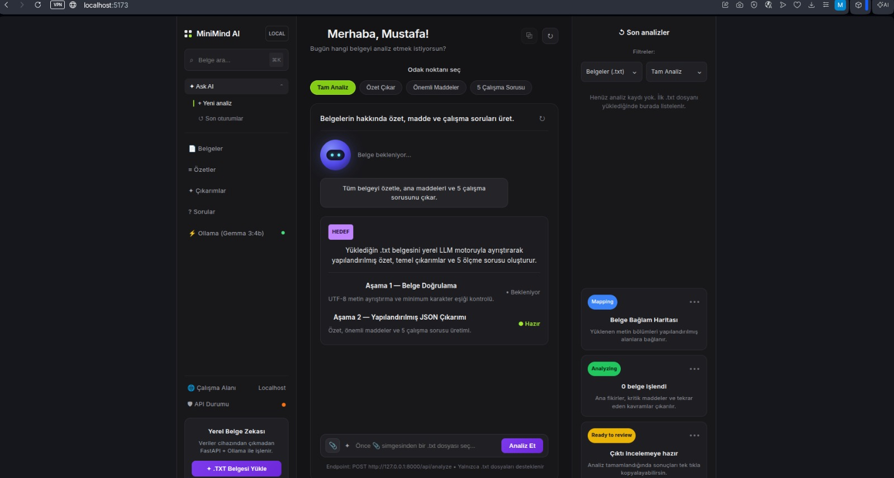

# MiniMind AI

React + Vite arayüzü ve FastAPI + Ollama (`gemma3:4b`) tabanlı yerel belge analiz aracı.

## Özellikler
- **3 Sütunlu Koyu Arayüz:** Odak modu seçimi, canlı durum kartları, analiz geçmişi ve tek tıkla Markdown kopyalama.
- **Yerel LLM İşleme:** FastAPI (`/api/analyze`) üzerinden `.txt` dosyalarını okuyup özet, önemli maddeler ve 5 çalışma sorusu üretir.
- **Test Altyapısı:** Backend testleri için `pytest` desteği.
## Arayüz Önizleme



## Proje Yapısı

```text
MiniMind-AI/
├── assets/
│   └── arayuz.jpeg
├── backend/
│   ├── app/
│   │   ├── __init__.py
│   │   ├── main.py
│   │   ├── routes/
│   │   ├── schemas.py
│   │   └── services/
│   ├── requirements.txt
│   └── tests/
│       ├── conftest.py
│       └── test_analyze.py
├── frontend/
│   ├── public/
│   ├── src/
│   │   ├── App.css
│   │   ├── App.jsx
│   │   ├── assets/
│   │   ├── index.css
│   │   └── main.jsx
│   ├── index.html
│   ├── package.json
│   ├── package-lock.json
│   └── vite.config.js
├── tests/
├── notlar.txt
├── .gitignore
└── README.md

## Çalıştırma

### Backend
```bash
cd backend
source ../.venv/bin/activate
PYTHONPATH=. uvicorn app.main:app --reload

### Frontend
cd frontend
npm install
npm run dev


